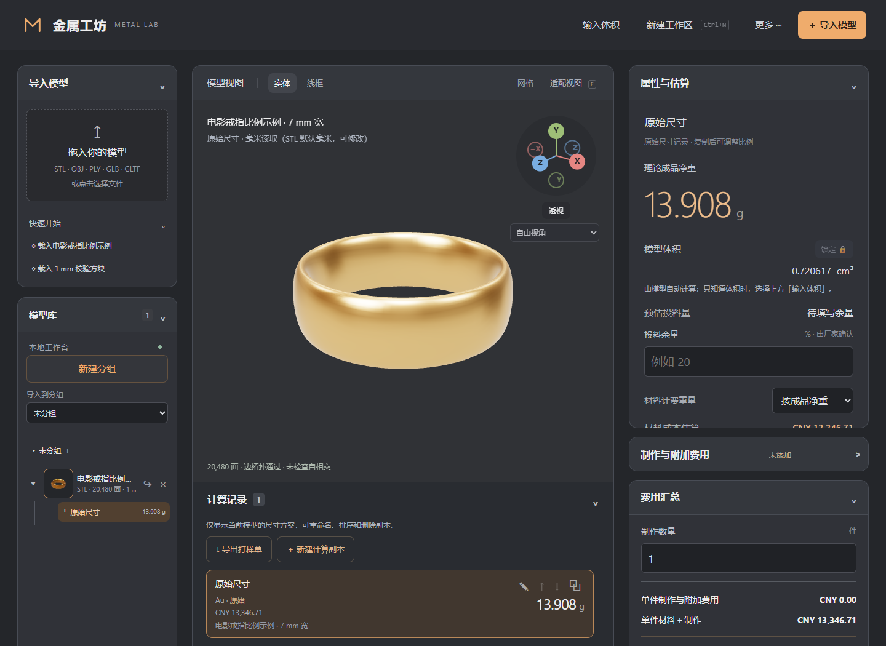
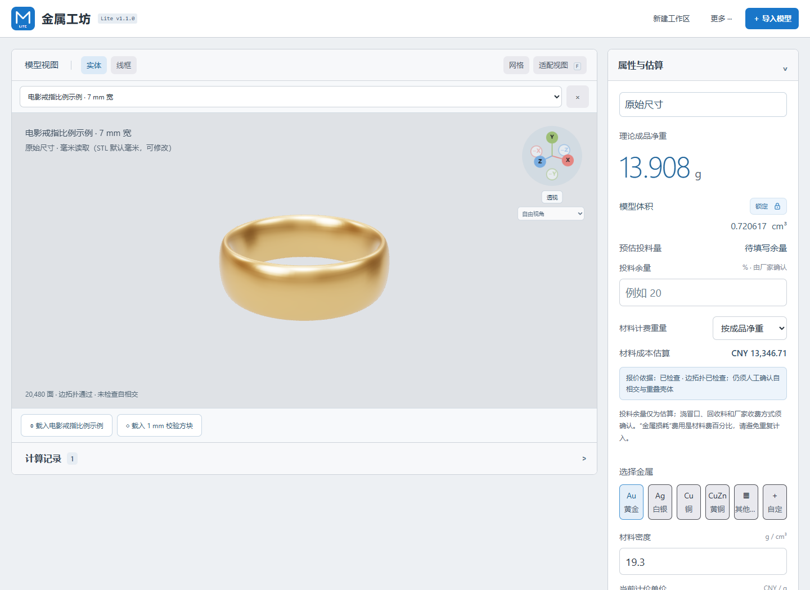
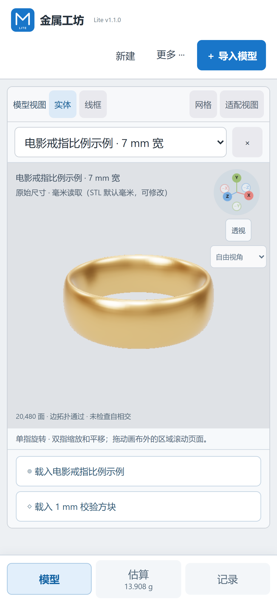
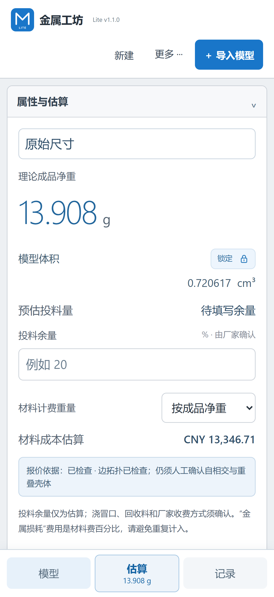

# 金属工坊 · Metal Lab

离线查看 3D 模型，计算体积和金属理论净重，并整理材料与制作费用的桌面工具。支持独立保存多个计算方案，适合金属工坊在打样前做尺寸与报价估算。

**开发者：CHAMBER** · 联系邮箱：[97101yy@gmail.com](mailto:97101yy@gmail.com)

> 当前小体积 Windows 发行版：标准版 V1.2.0 / Lite V1.1.0。复用系统 WebView2，应用 ZIP 约1.2 MB；运行环境需另计。旧 Electron 和 Linux 版本保留用于回退。模型重量和价格均为估算，正式投料与报价应由工坊核对模型、损耗、工艺和实际行情。

## 界面与操作图

三种版本都可从 **更多 → 使用说明** 打开软件内教程；新版已把该入口前移。完整操作步骤见 [三版本图文使用手册](docs/USER-GUIDE.md)。

新平台包同时附带可离线阅读的 **软件使用说明.html**，内容覆盖标准版、Lite和iPhone；也可查看[说明书源文件](docs/MANUAL.html)。

| 版本 | 适合用途 | 使用说明 |
|---|---|---|
| 标准版 | 模型分组、尺寸方案、制作费用和完整导出 | [标准版图文步骤](docs/USER-GUIDE.md#标准版) |
| Lite 桌面版 | 基础体积、克重、密度和材料估算 | [Lite 使用说明](docs/LITE.md) |
| Lite 手机版 | Safari 免安装使用、触屏计算和文件保存 | [iPhone 使用说明](docs/IPHONE.md) |

**标准版：载入示例、查看模型及克重。**



**Lite 桌面版：浅色界面，保留基础计算。**



**Lite 手机版：模型、估算、记录三栏切换。**

 

## 获取与运行

**iPhone 免安装网页预览：** Safari 打开 [MetalLab Lite 网页](https://hindingonhome.github.io/-/)，使用手机专用“模型 / 估算 / 记录”界面。可从“文件”导入模型及保存 .mlab；可选添加到主屏幕。真实 iPhone 和旧 iOS 尚需实机验收，详情见 [iPhone 使用说明](docs/IPHONE.md)。

在 [Releases 下载页](https://github.com/hindingonhome/-/releases)下载最新版本：

**标准版与 Lite 独立更新：** [Standard V1.2.0](https://github.com/hindingonhome/-/releases/tag/V1.2.0) 提供分组、尺寸方案、几何导出和制作费用；[Lite v1.1.0](https://github.com/hindingonhome/-/releases/tag/Lite-V1.1.0) 提供浅色三语界面、示例模型、体积/克重、手动单价和基础记录整理。Lite 使用独立应用标识、数据目录和蓝色图标，可与标准版并存。详见 [Lite 使用说明](docs/LITE.md) 和 [Lite 更新日志](docs/LITE-CHANGELOG.md)。

- **Windows 平台 ZIP**：新版本解压完整ZIP运行 Standard-Slim / Lite-Slim EXE。旧Electron版本仍包含安装版和便携版。
- **Linux x64 旧版平台 ZIP**：解压内部 tar.xz 后运行程序；Linux 构建尚需实机验证。
- **离线浏览版**：各平台 ZIP 内附 Offline.html，使用 Chrome、Edge 等现代浏览器打开。
- 新标准版提供Windows ZIP；新Lite提供Windows ZIP和iPhone-Web ZIP。另附各自 `SHA256SUMS.txt`；说明、日志、HTML、图标和许可放在包内，不散装上传。

软件无需注册账号，核心计算在本机完成。默认联网获取金、银、铂、钯的参考行情：启动和每 5 分钟更新，可关闭自动更新或点击立即更新。行情源为 Gold API，汇率源为 Frankfurter / ECB；网络请求不包含模型及报价。采用最新参考价只修改当前记录，不自动覆盖手动报价。铜、铝、锡及合金等暂无自动行情，需填写采购报价。断网显示缓存及行情时间；过期数据禁止一键采用。详见 [行情说明](docs/ONLINE-MARKET.md)。Windows 安装程序目前没有商业代码签名证书；请只从本仓库的发布页下载，并核对发布附件中的 `SHA256SUMS.txt`。

## 快速使用

1. 导入 STL、OBJ、PLY、GLB 或 GLTF 模型。GLTF 如引用外部 BIN 文件，请一起选择。每次导入先**确认模型尺寸单位**；取消确认不会添加该模型。
2. 在模型库新建分组，通过模型旁的 ↪ 按钮移动模型；导入前可选择目标分组。选中模型后，计算记录仅显示该模型的尺寸方案，可重命名、上下排序及删除副本。查看体积、理论成品净重和拓扑提示。尺寸可另建方案调整；导入源记录保留。
3. 选择金属并检查密度、每克单价。提供金、银、铜及铝、锡等常用金属预设；密度和价格可按实际材料修改。
4. 在制作与附加费用中选择工艺模板，或直接手动添加费用。未填写的工艺单价不会计入当前总额。
5. 在费用汇总核对单件及整批估算。桌面版用 `Ctrl+S` 保存 `.mlab` 工程，用 `Ctrl+Shift+S` 另存为。还可导出打样单、文本报告或模型；**导出模型前须确认输出单位**。

“更多”菜单可切换简体中文、繁体中文、英语、日语、韩语，以及显示单位 mm／cm／in／ft。显示单位只换算尺寸读数与输入，不更改模型实际物理大小。金额内部以人民币保存，可切换 CNY、USD、HKD、JPY、KRW、EUR、GBP、AUD、CAD、SGD。币种换算联网更新 ECB 每日参考汇率，失败时使用标明日期的缓存或内置快照，并非实时交易汇率。

浏览器版和桌面版的本机数据互相独立。要跨电脑继续计算，请把 `.mlab` 工程文件和重要原始模型一起带走。

## V1.1.0 工作区管理

- 不再限制为 12 个模型、100 份记录。预览几何与记录开销按 512 MiB 工作区预算检查；单个 `.mlab` 文件仍受 512 MiB 限制。高面数模型占用较大，容量并非无限。
- 新建、重命名、折叠分组；组内模型移动不改变尺寸、克重及报价。删除分组必须先移出模型。分组归属和折叠状态随工程保存，旧工程默认归入“未分组”。
- 计算列表跟随当前模型，只统计该模型的方案；排序仅影响同一模型，打样单选择也限定当前模型。列表独立滚动。
- 桌面版 `Ctrl+N` 或“更多 → 新建工作区”创建空白工作区。有数据时可保存后新建、直接新建或取消；新建会清除导入模型、记录、分组及用户导入行情，保留语言、单位、货币及自动行情偏好。不会删除磁盘文件。
- 新建后解除旧工程的保存路径关联，首次保存需选新路径。浏览器可能保留 Ctrl+N 快捷键，请使用菜单；浏览器下载无法确认是否落盘，保存后需再次确认新建。
- 请先另存旧工程再试用。V1.1.0 分组及排序数据不保证在旧版显示。

完整变更见 [开发日志](CHANGELOG.md)；验收步骤见 [V1.1.0 使用与验收说明](docs/V1.1.0-ACCEPTANCE.md)。

## 从源码构建

需要 Node.js 24 和 pnpm 11.25.0。在项目目录运行：

```sh
pnpm install --frozen-lockfile
pnpm test
pnpm build
```

构建后可直接打开 `dist/金属工坊.html`。在 Windows 上运行桌面版或制作两种 EXE：

```sh
pnpm desktop:dev
pnpm desktop:dist
```

在 Linux x64 上运行 `pnpm desktop:linux` 可生成便携压缩包。

更多维护方法见 [更新与发布说明](docs/RELEASING.md)。

## 范围与版权

STL 等网格的体积计算依赖模型封闭程度；边拓扑通过也不能证明不存在自相交或重叠壳体。材料损耗和制作工艺需要人工确认。软件不提供实时市场报价承诺。

本仓库**保留所有权利，暂不授予开源许可**。源代码可查看，但修改、再分发或商用需联系 CHAMBER 获得许可。Third-party 组件按 [第三方许可证](THIRD_PARTY_LICENSE.txt)执行。


## 2026-10-29 验收补充

标准版模型可拖入分组标题，F2或双击分组名称重命名；新建工作区在顶栏显示Ctrl+N。黄铜移入铜后的常用入口。免费废黄铜服务实测不可用，界面标注未接通，不提供虚构价格。Lite 采用独立 `Lite-V1.0.0` 标签和平台包，固定浅色、三种语言，计算记录上方可载入戒指及方块。Windows 7/8.1 不支持当前桌面运行时，备用 HTML 的旧系统兼容性也未验证。

## 小体积架构与兼容性

Windows 使用系统 WebView2 + .NET Framework，未内置浏览器。建议 Windows10/11 x64、.NET4.8及以上。缺少WebView2时提示前往微软官方下载；运行环境自身仍占空间。原Electron最近工程、文件关联及超大文件直接写盘尚未完全替代。完整差异见[标准版说明](docs/STANDARD-SLIM.md)和[Lite说明](docs/LITE-SLIM.md)。需要旧原生能力或Linux时保留旧版。
