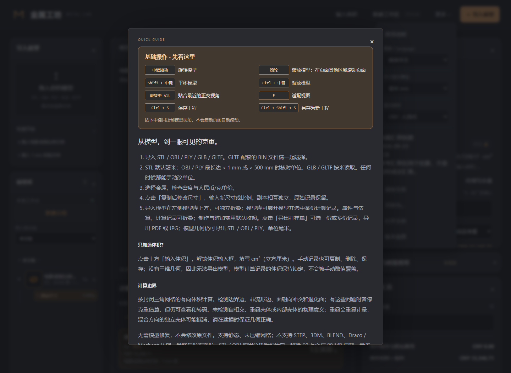
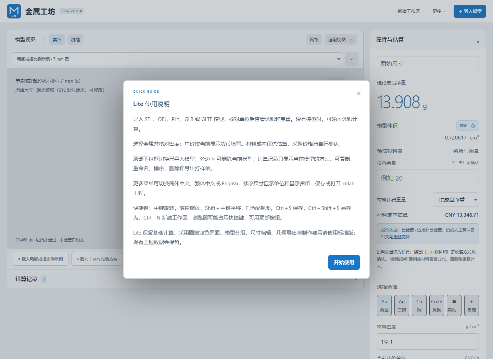
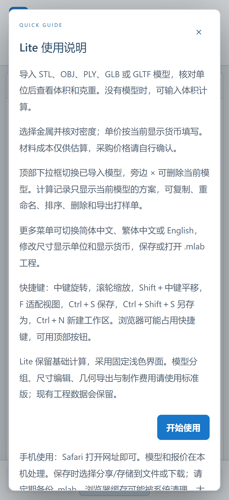

# 三版本图文使用手册

更新：2026-10-30。截图来自实际运行界面，手机截图为402×874逻辑像素、3倍像素比的模拟环境；真实 iPhone 的系统栏效果仍以设备为准。

## 标准版

1. 先载入内置戒指或1 mm方块熟悉操作；正式使用点击“导入模型”，选择模型文件，确认与建模软件一致的尺寸单位。
2. 模型区查看形状；选择金属，核对密度、体积和理论净重。净重=体积×密度。网格异常提示需要人工确认。

3. 模型库可分组整理，计算记录随当前模型切换；创建副本后修改尺寸，可对比不同方案。
4. 如需报价，填写采购单价和报价依据；按需要添加制作费用并检查单件、整批总额。参考行情不等于实际成交报价。
5. 通过“更多”保存 .mlab 工程，或从计算记录导出打样单；几何导出时再次确认输出单位。

“更多 → 使用说明”提供快捷键、格式支持、计算边界和工作区说明。

## Lite 桌面版

1. 点击计算记录上方的戒指或方块示例，或导入自己的模型并确认单位。
2. 使用模型下拉框切换模型，选择金属并核对密度；按显示货币输入每克单价。

3. 展开计算记录，可重命名、复制、排序或删除副本，导出 PDF/JPG 打样单。
4. 仅知道体积时，从“更多 → 输入体积”进入，解锁体积框后填写 cm³。
5. “更多”中保存、另存为或打开 .mlab。新建会清空当前工作区，重要数据请先保存。

Lite 不显示标准版的模型分组、尺寸编辑和制作费用面板；这些功能可在标准版使用。

## Lite 手机版

1. Safari 打开 https://hindingonhome.github.io/-/ ，无需安装。也可从分享菜单添加到主屏幕。
2. “模型”页导入文件或载入示例；单指旋转，双指缩放和平移，在画布外滑动滚动页面。

3. 底部“估算”查看净重、选择金属、修改密度和手动单价。顶部“新建”是清空工作区操作，使用前先保存。

4. “记录”整理当前模型方案；点击重命名会切换到估算页并定位名称输入框。
5. “更多 → 保存文件”后，选择分享/存储到文件或下载，把 .mlab 保存到“文件”或 iCloud Drive。打开工程时从“文件”选择 .mlab。
6. “更多 → 使用说明”可随时打开三语教程。

手机对模型和工程有资源上限，详见 [iPhone 说明](IPHONE.md)。大模型可能使用抽样预览，体积仍按完整网格计算。系统可能清理浏览器缓存，须定期导出工程备份。
